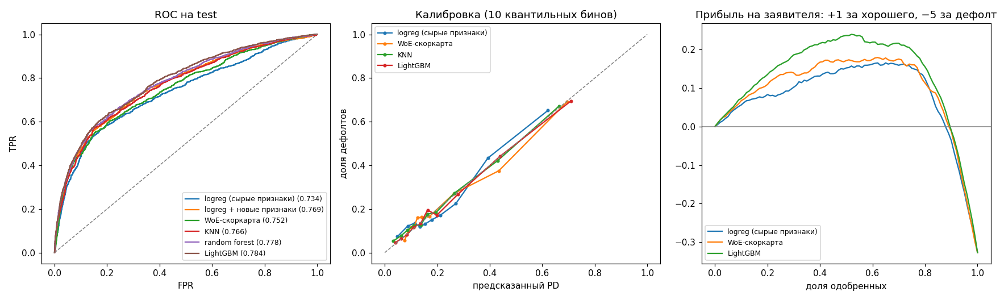

# Кредитный скоринг: от EDA до A/B-теста

Модель вероятности дефолта (PD) по кредитной карте на данных UCI *Default of Credit Card Clients*
(30 000 клиентов тайваньского банка, 2005, дефолт у 22,1%). Полный цикл: EDA и проверка гипотез,
генерация признаков, бейзлайн на логистической регрессии, WoE-скоркарта, KNN, случайный лес,
три бустинга, интерпретация, экономика порога и симуляция A/B-теста.

> Подробный разбор каждого шага, теории и того, что спрашивают на собеседованиях, — в [GUIDE.md](GUIDE.md).

## Результаты

Отложенный test — 6 000 клиентов, модели выбирались только по 5-fold CV на train.

| модель | CV ROC-AUC | test ROC-AUC [95% ДИ] | Gini | KS |
|---|---|---|---|---|
| **LightGBM** | **0.789 ± 0.004** | **0.784** [0.770–0.797] | 0.568 | 0.434 |
| CatBoost | 0.789 ± 0.004 | 0.784 [0.770–0.797] | 0.568 | 0.438 |
| XGBoost | 0.789 ± 0.004 | 0.782 [0.768–0.795] | 0.563 | 0.431 |
| Random forest | 0.787 ± 0.004 | 0.778 [0.763–0.791] | 0.556 | 0.427 |
| Логрегрессия + новые признаки | 0.780 ± 0.006 | 0.769 [0.755–0.782] | 0.538 | 0.411 |
| KNN (k = 200) | 0.778 ± 0.004 | 0.766 [0.752–0.780] | 0.532 | 0.421 |
| WoE-скоркарта (10 признаков) | 0.767 ± 0.008 | 0.752 [0.737–0.767] | 0.503 | 0.398 |
| Логрегрессия на сырых признаках (бейзлайн) | 0.749 ± 0.008 | 0.734 [0.720–0.750] | 0.469 | 0.388 |

- **Бустинг лучше бейзлайна на ΔAUC = +0.050** [+0.039; +0.060] (парный бутстрэп по клиентам test).
  Больше половины прироста дают **новые признаки, а не модель**: та же логрегрессия с ними получает +0.035.
- Три бустинга неразличимы между собой (интервалы перекрываются): упор на данные важнее выбора библиотеки.
  Разброс CV между 16 конфигурациями LightGBM — 0,779–0,789.
- **Экономика.** При условной прибыли +1 за одобренного «хорошего» и −5 за дефолтника оптимальный порог LightGBM
  одобряет 52% заявок с долей дефолтов 9,0% и даёт **0,239 на заявителя против 0,165 у бейзлайна (+45%)**.
- **A/B-тест (симуляция).** При одинаковой доле одобрений (70%) новая модель снижает bad rate с 12,9% до 11,5%,
  но на 2 100 одобренных в группе мощность теста лишь 24%: для 80% нужно ≈ 9 100 клиентов в группе.
  A/A-тест даёт 5,1% ложных срабатываний — тест откалиброван.
- Главный сигнал — **недавние просрочки** (`delay_recent2`, `PAY_1`, IV = 0,88). Демография слабая
  (IV(AGE) = 0,02, IV(SEX) = 0,01), и пол в скоринге использовать юридически спорно.



Полные отчёты: [EDA и гипотезы](reports/eda.md) · [сравнение моделей, SHAP, скоркарта](reports/results.md) ·
[A/B-тест](reports/ab_test.md).

## Что сделано

1. **EDA и гипотезы** ([reports/eda.md](reports/eda.md)). Шесть гипотез проверены на train: просрочка, утилизация
   лимита (зависимость U-образная), доля погашения, лимит, демография, мультиколлинеарность сумм счетов (r = 0,80–0,95).
2. **Признаки** ([src/credit_scoring/features.py](src/credit_scoring/features.py)): утилизация, доля погашения,
   статистики просрочек, давность последней просрочки, тренды. Все построчные — утечки между train и test нет (есть тест).
3. **WoE-скоркарта** — классическая банковская модель: квантильные бины → Weight of Evidence → логрегрессия →
   баллы (600 при шансах 50:1, PDO = 20). Признаки с «неправильным» знаком коэффициента (следствие
   мультиколлинеарности) удаляются итеративно, как это делают при построении реальных скоркарт.
4. **Модели и подбор**: KNN (k по CV), random forest, LightGBM (случайный поиск по 16 конфигурациям), CatBoost, XGBoost.
5. **Оценка**: ROC-AUC, Gini, KS, PR-AUC, Brier, LogLoss, калибровка, бутстрэп-интервалы, парный бутстрэп для разницы.
6. **Интерпретация**: TreeSHAP из LightGBM (`pred_contrib`), коэффициенты и балльная карта скоркарты.
7. **A/B-тест**: z-тест для долей, мощность по 2 000 рандомизациям, A/A-проверка, расчёт размера выборки.

Продолжение — сервис с этой моделью: [credit-scoring-service](https://github.com/Killvarus/credit-scoring-service)
(FastAPI, Docker, Airflow, мониторинг дрейфа, Telegram-бот).

## Запуск

```bash
pip install -r requirements.txt
python scripts/eda.py        # EDA и гипотезы → reports/eda.md
python scripts/train.py      # подбор и сравнение моделей → reports/results.md (~15 мин на CPU)
python scripts/ab_test.py    # симуляция A/B-теста → reports/ab_test.md
pytest                       # 12 тестов: признаки, WoE, метрики, A/B
```

Данные скачиваются автоматически с OpenML (зеркало UCI, `data_id=42477`) в `data/`.

## Структура

| путь | что там |
|---|---|
| `src/credit_scoring/data.py` | загрузка, очистка недокументированных категорий, разбиение |
| `src/credit_scoring/features.py` | признаки и WoE-биннинг с Information Value |
| `src/credit_scoring/models.py` | все модели как sklearn-пайплайны, скоркарта с контролем знаков |
| `src/credit_scoring/metrics.py` | Gini, KS, бутстрэп, кривая прибыли |
| `src/credit_scoring/ab.py` | z-тест, размер выборки, симуляция политики одобрения |
| `scripts/` | EDA, обучение, A/B |
| `reports/` | отчёты и графики (генерируются скриптами) |
| `tests/` | тесты на синтетических данных |
